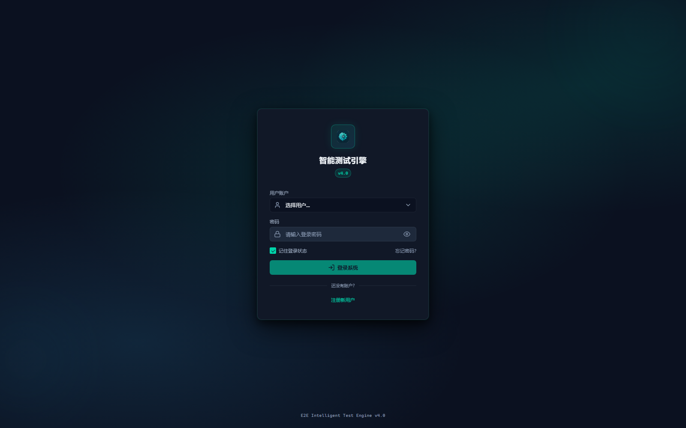
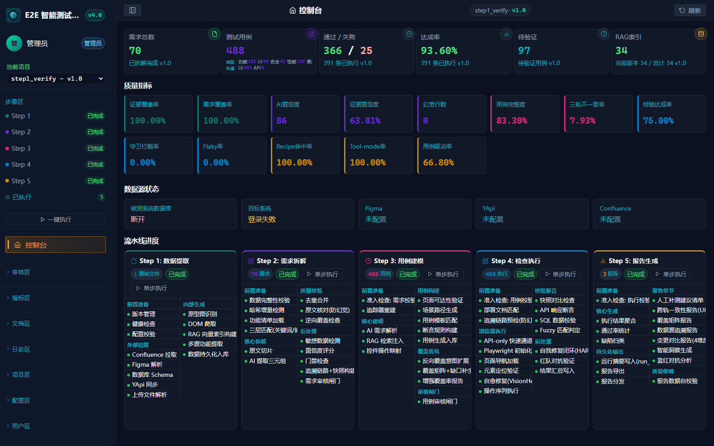
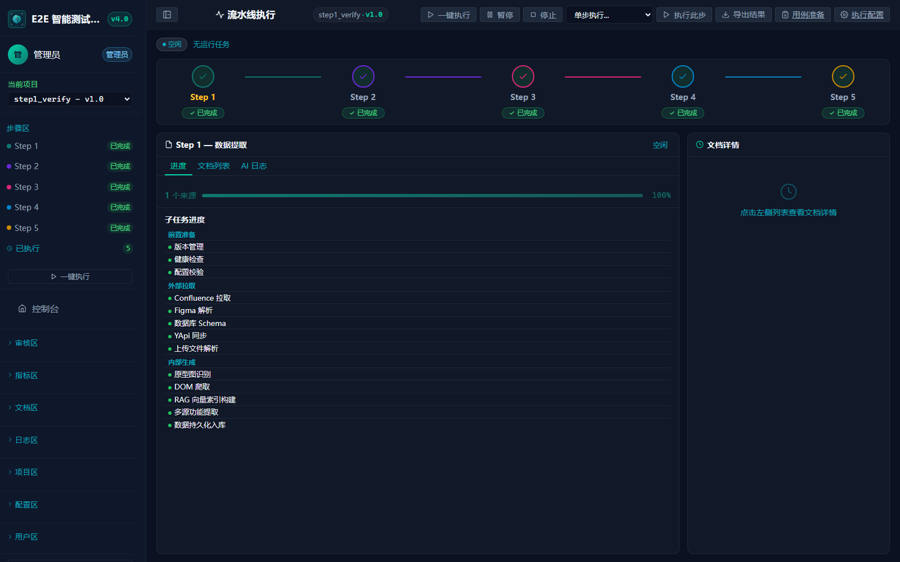
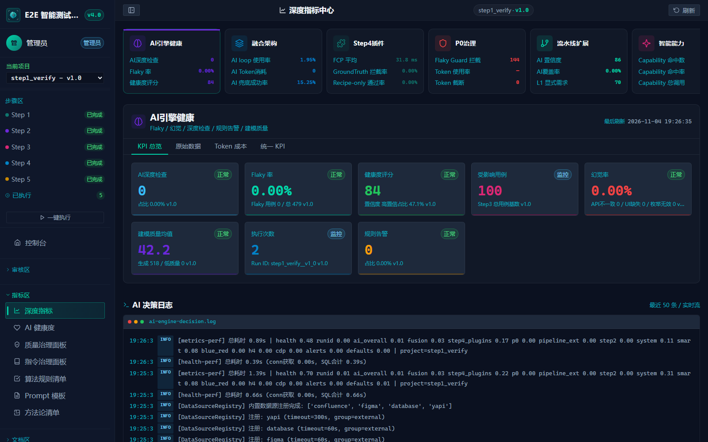
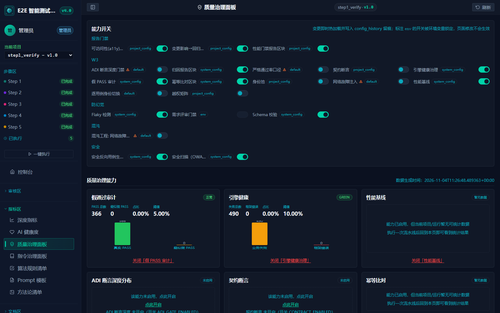
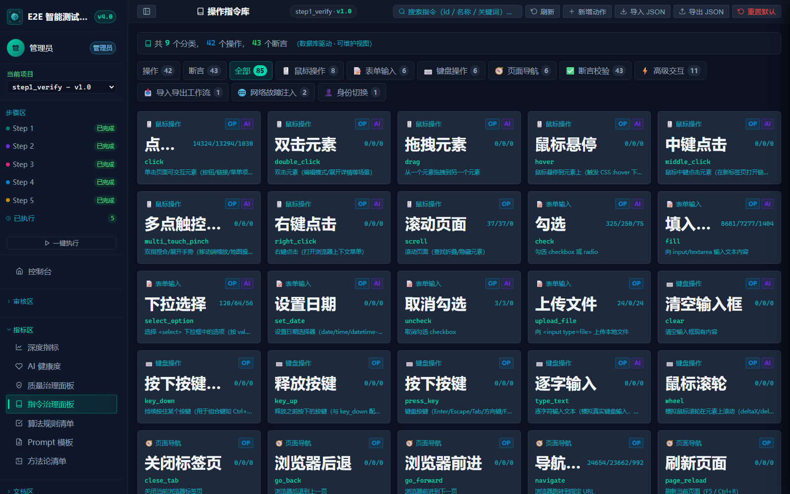

# E2E 智能测试引擎（AI Test Engine）

面向 Web 系统的端到端 AI 测试引擎：需求分析 → 用例生成 → 浏览器执行 → 验证报告，覆盖功能、异常、边界、安全、性能、可访问性等横切维度。
规则驱动 + LLM 辅助，目标是在不同系统/行业/页面上复用同一套引擎能力，而不是录制回放式的脚本执行。

## 界面预览

| 登录页 | 控制台（总览） |
|---|---|
|  |  |

| 流水线执行（五步链路） | 深度指标中心 |
|---|---|
|  |  |

| 质量治理面板 | 操作指令库 |
|---|---|
|  |  |

## 核心能力

- **五步流水线**：Step1 数据采集/RAG → Step2 需求拆解 → Step3 用例生成 → Step4 浏览器执行 → Step5 报告生成，Step2/Step3 后有人工审核闸门。
- **导航图（唯一事实源）**：从真实页面 DOM 发现菜单/同源链接，落库 `nav_graph_nodes`；导航目标解析不到时显式标注「目标页未解析」，执行端如实判失败，不把站点根伪装成目标页。
- **混合执行**：结构化动作 + AI 兜底；断言族/强度契约、表单填充策略、证据预算、自愈与长短期记忆插件。
- **横切门禁**：可访问性、安全、性能（相对基线回归）、视觉审核，结果进入报告与聚合评分。
- **人机协同**：Web 控制台提供流水线编排、用例评审、指标中心、质量治理、操作指令库、日志面板等页面。

## 快速开始

```bash
pip install -r requirements.txt
cp .env.template .env   # 填入 MySQL / AI 服务等实际配置
python main.py          # 启动 Web 控制台（默认 127.0.0.1:8700）
```

- 默认管理员账号：`admin` / `admin123`（仅本地开发默认值，部署前请修改）
- 元数据库：MySQL（库名 `ai_test_engine`，首次启动自动建表）
- 详细架构与修复记录见 [AGENTS.md](AGENTS.md)、[docs/](docs/)

## 目录结构

```
src/           引擎主体（backend 路由/前端模板、pipeline 五步、core 基础设施、ai 能力）
tests/         单元/集成测试
scripts/       运维与实证脚本
docs/          技术手册与设计文档
deliverables/  交付说明文档
```

## 免责声明

本项目为个人**自我研发、学习研究**用途的开源项目，**仅供学习与交流**。

- 按「现状」提供，不附带任何明示或默示的担保；
- 作者不对使用本软件造成的任何直接或间接损失承担责任；
- 请勿将本项目用于任何未经授权的系统测试或非法用途，使用者需自行确保测试行为合法合规并已获得相应授权；
- 仓库内不包含任何第三方商业系统的代码或数据，示例数据均为自建测试数据。

## License

[MIT](LICENSE) © 2026 ai_test_project contributors
