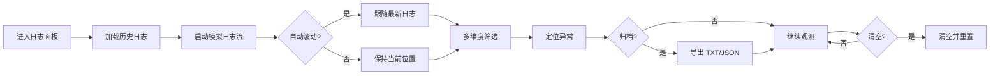

# 产品需求文档 (PRD) — E2E 智能测试引擎 · 日志面板

## 1. 产品概述
面向 E2E 智能测试引擎运维人员与开发者的实时日志观测面板，用于追踪 5 步流水线（数据拉取→需求拆解→用例建模→检查执行→报告生成）的执行过程、AI 调用、Token 消耗与异常重试。
- **目标用户**：测试工程师、平台运维、研发人员
- **核心价值**：以终端美学呈现流水线全链路日志，支持多维度筛选、实时滚动、错误追踪与导出归档，让问题定位从"翻文件"变为"看面板"

## 2. 核心功能

### 2.1 用户角色
| 角色 | 进入方式 | 核心权限 |
|------|----------|----------|
| 管理员 | 账号登录 | 查看日志、清空日志、导出、配置数据源与系统设置 |
| 观察者 | 账号登录 | 查看日志、导出（不可清空） |

### 2.2 功能模块
1. **日志面板（主页）**：侧边栏导航 + 日志流主区 + 顶部工具栏 + 筛选标签 + 搜索条 + 底部状态栏
2. **侧边导航**：Logo/用户/环境选择器/一键执行/流水线步骤/页面导航/底部配置入口
3. **日志流**：终端风格日志条目，按时间戳/级别/来源/消息渲染，支持高亮、错误左条标记
4. **筛选与搜索**：标签页分类（全部/Step1-5/系统/错误）、级别开关（INFO/WARN/ERROR/DEBUG）、关键词搜索、时间范围
5. **交互操作**：自动滚动开关、清空日志、导出（TXT/JSON）、分页、上下行导航

### 2.3 页面详情
| 页面名称 | 模块名称 | 功能描述 |
|----------|----------|----------|
| 日志面板 | 侧边栏 | Logo+版本徽标、用户头像与角色、环境下拉、一键执行按钮、流水线 5 步导航（带彩点）、页面导航（控制台/流水线执行/日志面板）、底部数据源配置与系统设置 |
| 日志面板 | 顶部工具栏 | 面包屑（日志面板）、清空日志（危险态）、导出、级别下拉过滤 |
| 日志面板 | 筛选标签栏 | 全部/Step1/Step2/Step3/Step4/Step5/系统/错误，每项带计数徽标，点击切换激活 |
| 日志面板 | 搜索条 | 关键词输入（mono 字体）、级别快切徽标（可点亮/熄灭）、时间范围下拉、自动滚动开关 |
| 日志面板 | 日志流区 | 终端风格条目：时间戳[级别][来源]消息，支持 highlight/value/metric/dim 多色高亮，错误条左侧红条 |
| 日志面板 | 状态栏 | 显示区间计数、最后更新时间、分页（上一页/下一页）、上下行导航计数 |
| 日志面板 | 模拟数据流 | 内置 mock 日志生成器，模拟流水线执行全过程，按节奏追加新日志，支持自动滚动跟随 |

## 3. 核心流程

用户进入面板 → 自动加载历史日志并启动模拟流 → 用户通过标签/级别/搜索/时间范围筛选 → 开启自动滚动跟随最新日志 → 发现错误后定位到具体 Step/REQ → 导出当前视图归档 → 必要时清空日志重新观测。

## 4. 用户界面设计

### 4.1 设计风格
- **主题**：深色终端美学（Dark Terminal Aesthetic），致敬开发者控制台
- **主色**：青绿 `#00d4aa`（Cyan-Teal），辅助紫 `#a78bfa`、粉 `#f472b6`、青蓝 `#38bdf8`、琥珀 `#f59e0b` 分别对应 Step1-5
- **背景**：深蓝黑 `#0b1120` / `#111827` / `#1e293b` 三级表面，日志区更深 `#0a0f1a`
- **字体**：正文 Inter + Microsoft YaHei；日志/代码 JetBrains Mono / Fira Code
- **圆角**：xs 3px / sm 4px / md 8px / lg 12px / full 9999px
- **布局**：左侧固定 260px 侧边栏 + 右侧弹性主区，顶栏 + 标签栏 + 搜索条 + 日志流 + 状态栏垂直栈
- **图标**：线性 SVG（lucide 风格），1px-2px 描边
- **动效**：日志条目淡入上滑、悬停高亮、级别徽标微动、开关切换过渡、自动滚动平滑跟随

### 4.2 页面设计概览
| 页面名称 | 模块名称 | UI 元素 |
|----------|----------|---------|
| 日志面板 | 侧边栏 | 渐变 Logo 块、版本胶囊、头像、角色徽标、环境下拉、彩点导航、渐变执行按钮 |
| 日志面板 | 顶部工具栏 | 面包屑图标+文字、危险态清空按钮、导出按钮带下载图标、级别下拉 |
| 日志面板 | 筛选标签栏 | 横向标签、激活态青绿下划线、计数胶囊 |
| 日志面板 | 搜索条 | mono 输入框聚焦发光、4 个级别快切徽标、时间范围下拉、青绿开关 |
| 日志面板 | 日志流 | 等宽字体、时间戳灰、级别彩色徽标、来源青绿、消息中 value 蓝/metric 琥珀/highlight 白 |
| 日志面板 | 状态栏 | 计数文字、mono 时间、分页按钮 hover 青绿底 |

### 4.3 响应式
- **桌面优先**（≥1280px）：完整双栏布局，侧边栏 260px 常驻
- **平板**（768-1279px）：侧边栏可折叠为图标条（72px），主区弹性扩展
- **移动端**（<768px）：侧边栏抽屉化（默认隐藏，汉堡按钮唤起），顶栏/标签栏/搜索条改为可横向滚动，日志条目时间戳与级别换行显示
- **触控优化**：按钮命中区 ≥ 36px，标签页间距加大，开关尺寸放大

### 4.4 3D 场景指引
- 不适用（纯 2D 仪表盘界面）
