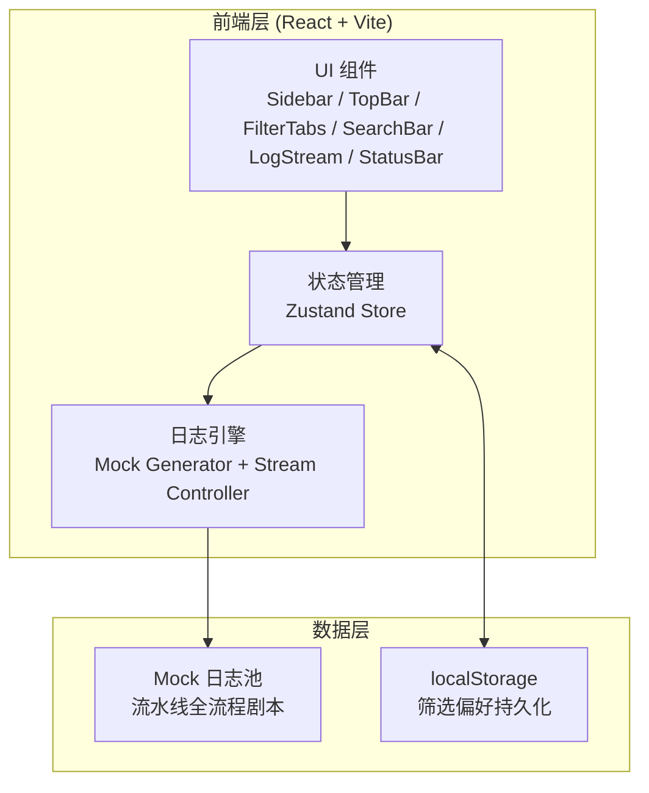

# 技术架构文档 — E2E 智能测试引擎 · 日志面板

## 1. 架构设计

纯前端单页应用，无后端服务，使用浏览器内存与本地 mock 数据模拟实时日志流。



## 2. 技术说明
- **前端框架**：React@18 + TypeScript
- **构建工具**：Vite@5
- **样式方案**：Tailwind CSS@3 + CSS 变量（复刻设计稿 Design Tokens）
- **状态管理**：Zustand（轻量、无样板）
- **图标**：lucide-react
- **初始化工具**：vite-init（`npm create vite@latest`）
- **后端**：无（纯前端 mock）
- **数据来源**：内置剧本式 mock 日志生成器，模拟 Step1-5 全流程，按时间节奏推送

## 3. 路由定义
| 路由 | 用途 |
|------|------|
| `/` | 日志面板主页（唯一页面，含侧边栏与主区） |

## 4. API 定义
无后端 API。前端通过 Zustand store 暴露以下动作：
```typescript
interface LogStore {
  logs: LogEntry[]                    // 全量日志
  filteredLogs: LogEntry[]            // 筛选后日志
  activeTab: TabKey                   // 当前标签 (all/step1-5/system/error)
  enabledLevels: Set<LogLevel>        // 启用的级别
  keyword: string                     // 搜索关键词
  timeRange: TimeRange                // 时间范围
  autoScroll: boolean                 // 自动滚动
  page: number                        // 当前页
  pageSize: number                    // 每页条数
  // 动作
  appendLog: (entry: LogEntry) => void
  clearLogs: () => void
  setTab: (tab: TabKey) => void
  toggleLevel: (level: LogLevel) => void
  setKeyword: (kw: string) => void
  setTimeRange: (range: TimeRange) => void
  toggleAutoScroll: () => void
  setPage: (p: number) => void
  exportLogs: (format: 'txt' | 'json') => void
}

interface LogEntry {
  id: string
  timestamp: string                   // HH:mm:ss.SSS
  level: 'INFO' | 'WARN' | 'ERROR' | 'SUCCESS' | 'DEBUG'
  source: string                      // [系统]/[Step1]/[API]...
  segments: LogSegment[]              // 消息分片段（支持多色高亮）
  step?: 1 | 2 | 3 | 4 | 5            // 归属步骤（用于标签筛选）
  isError?: boolean                   // 错误条标记
}

interface LogSegment {
  text: string
  type?: 'normal' | 'highlight' | 'value' | 'metric' | 'dim'
}
```

## 5. 服务端架构
不适用（纯前端项目）。

## 6. 数据模型
### 6.1 数据模型定义
无持久化数据库。内存数据结构见 §4。筛选偏好（启用级别、自动滚动、时间范围）持久化到 localStorage。

### 6.2 数据定义语言
不适用。Mock 日志剧本以 TypeScript 常量数组形式定义在 `src/mock/scenario.ts`，模拟一次完整流水线执行（约 50 条日志），循环播放并递增时间戳。
